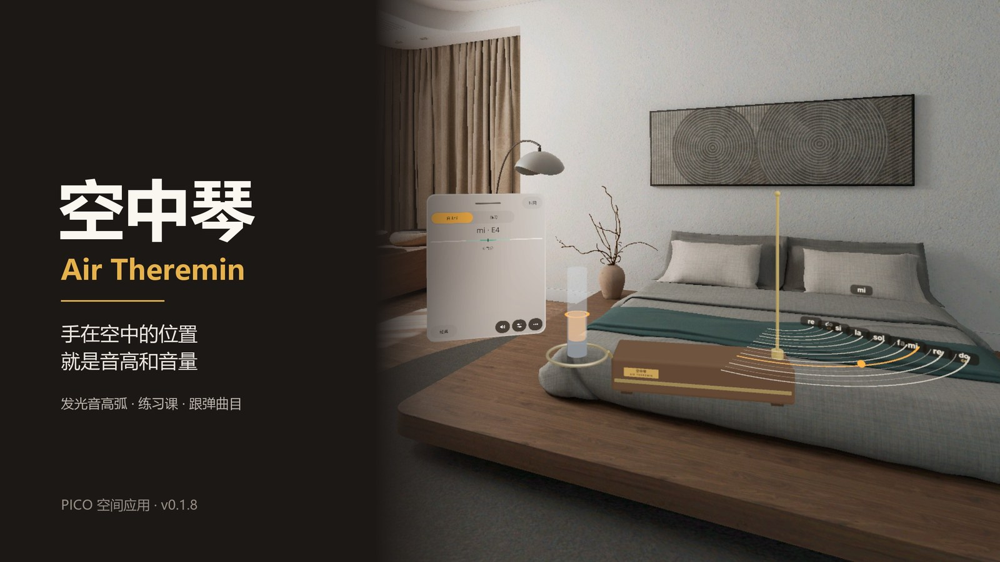
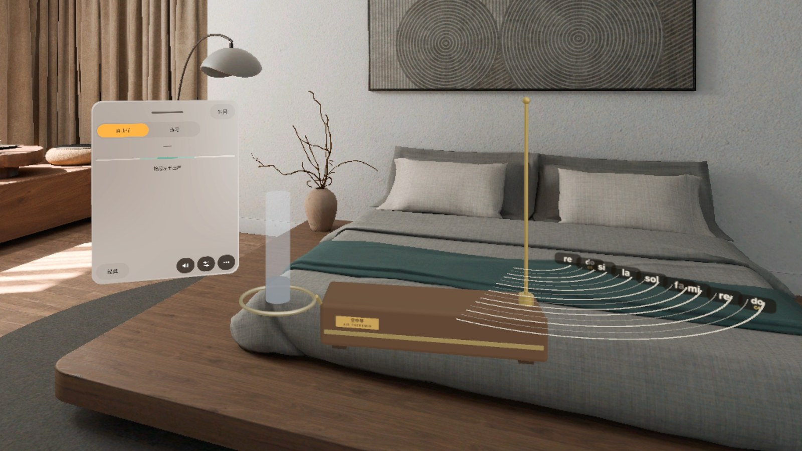
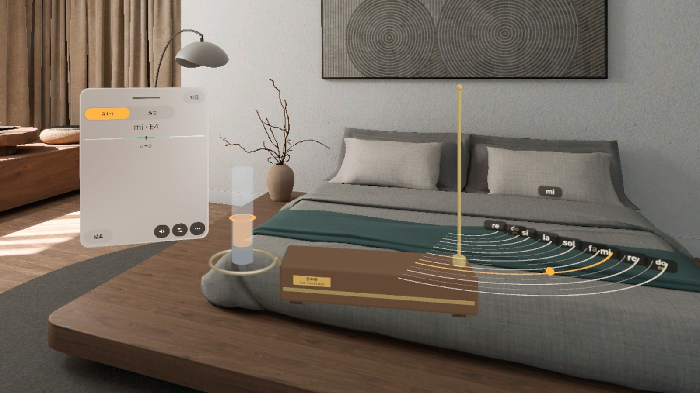
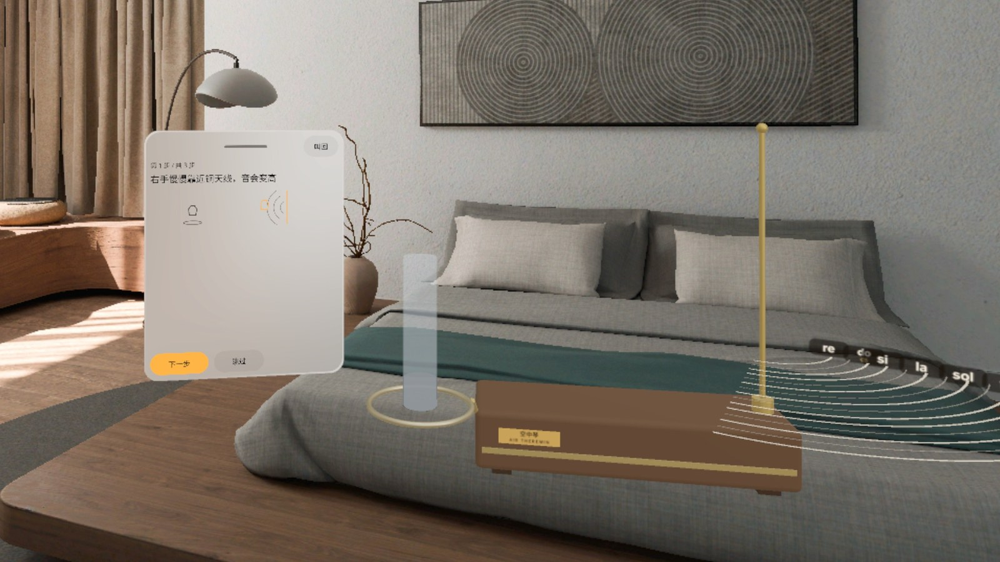
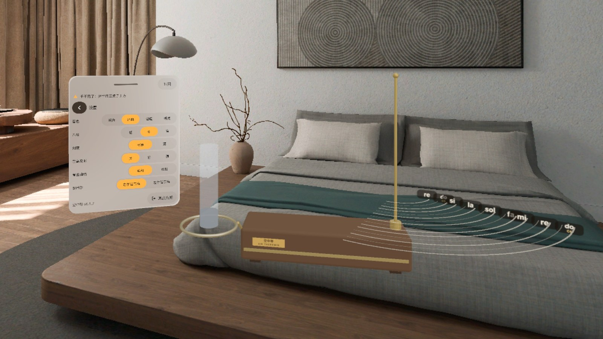
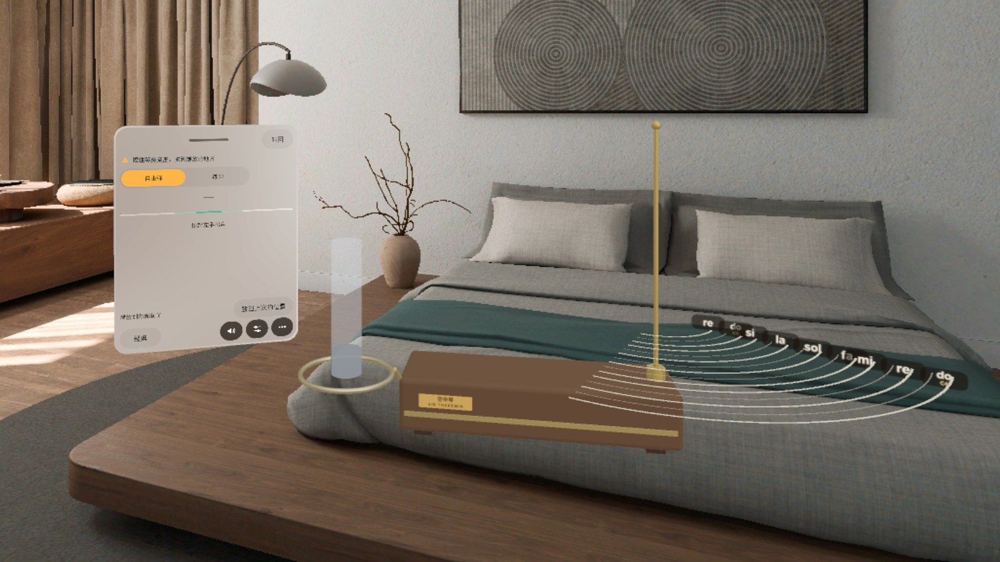
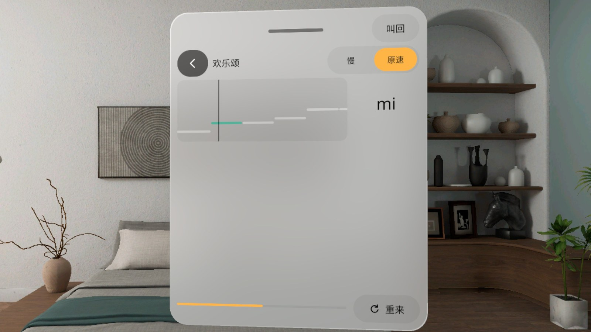

# 空中琴 Air Theremin



**中文** · [English](#english)

PICO 空间应用：一台特雷门琴出现在你面前，**手在空中的位置就是音高和音量**——右手靠近铜天线音变高，左手从音量环上抬起就出声。天线周围一圈圈发光的音高弧告诉你手该停在哪；6 节练习课和 6 首跟弹曲目给你的音准打分。

- 下载：[Releases · v0.1.8](https://github.com/kejing-dev/Theremin/releases/tag/v0.1.8)（`AirTheremin-v0.1.8.apk`）
- 设备：PICO OS 6（Spatial SDK 6.1.9），混合现实（透视），手势追踪 / 手柄都能弹
- 不联网、不需要账号；中英双语

## 截图

> 以下都是模拟器截图（中文界面，调试输入驱动手的位置），**不是真机画面**。

| | |
|---|---|
|  |  |
| **首页**：琴和谱架面板一起出现在正前方，谱架在琴的音量环一侧，上沿不高于眼睛（v0.1.8） | **自由弹**：右手的光珠落在音高弧上，面板实时显示音名「mi · E4」（v0.1.7） |
|  |  |
| **第一次打开的引导**：「下一步 / 跳过」，教你两只手各管什么（v0.1.7） | **设置**：音色、八度、刻度、音高吸附、音量曲线、惯用手，控件一律 48 dp（v0.1.7） |
|  |  |
| **放回上次的位置**：上次摆的位置在身后时，启动先放到正前方，按一下再回去（v0.1.8） | **跟弹《欢乐颂》**：目标线卷帘、慢速 / 原速、重来（面板特写，v0.1.5 截图，这一页之后没改） |

## 怎么弹

1. 打开应用，琴和谱架出现在正前方（上次摆过的位置在你视野里就放回原处）。
2. **右手**靠近竖直的铜天线 → 音变高（每 2.2 cm 一个半音，A4 = 440 Hz）；**左手**从水平音量环上抬起 → 音量变大，放回环上就静音。
3. 跟着发光的音高弧找音；谱架上选「练习」做 6 节课（长音 do / sol、do re mi、音阶上行 / 下行、跳音），或选曲目跟弹。
4. 想换位置：看着琴身捏合（或手捏住 / 手柄扳机）拖到别处，松手就停住；下次启动回到这里。

**练习课**：长音 · do、长音 · sol、do re mi、音阶 · 上行、音阶 · 下行、跳音 · do mi sol
**跟弹曲目**（全部公版）：欢乐颂、小星星、两只老虎、茉莉花、送别、天鹅（第一句）

## 安装

```bash
adb install -r AirTheremin-v0.1.8.apk
pico-cli app launch io.embodit.theremin
```

包名 `io.embodit.theremin`，versionName 0.1.8 / versionCode 9（debug 构建，只用于评审和体验）。

## 版本历程（每一版都来自用户在头显上的反馈）

| 版本 | 改了什么 |
|---|---|
| v0.1.8 | 启动时上次摆放的位置如果在你身后（换了朝向），琴放到正前方，谱架上给「放回上次的位置」；琴身可以直接捏住拖动 |
| v0.1.7 | 面板拖动不再抖、不再绕圈；谱架从天线顶上挪到琴旁边，上沿低于眼睛 |
| v0.1.6 | 冷启动先出加载面板「正在调音…」，不再空等；首页音色按钮加大到 48 dp |
| v0.1.5 | 删掉给现实物体加的碰撞体（显示器挡琴、射线被墙挡住）；面板一律竖直；设置控件 48 dp；设置里加「退出应用」 |
| v0.1.4 | 改用世界锚点，不再需要桌面；去掉嗡嗡声 |
| v0.1.3 | 用空间锚点摆放、放好后随时可拖；音色不再像电波干扰；谱架面板跟着琴朝向你 |
| v0.1.2 | 修正琴和面板的朝向，内容不再用头的朝向来放 |

## 已知情况

- 截图和演示视频都来自模拟器，手的位置是调试命令注入的，**非真实手势录像**；真机上的手感以你自己试为准。
- v0.1.8 的模拟器 QA（第 5 轮）跑到一半用户就放行发布了，没跑完的项写在 Release 说明里；v0.1.7 的 QA 第 4 轮模拟器全过，v0.1.8 已在头显上冷启动三种情况验过摆位。
- 「天鹅」第一句是凭记忆转写（G→C 移调），还没对照 IMSLP 总谱。

## 开发

Kotlin + PICO Spatial SDK 6.1.9，一个混合现实 Stage（Full Space，透视）。结构、调试广播和 QA 钩子见 [AGENTS.md](AGENTS.md)。字体 Noto Sans / Noto Sans SC（SIL OFL 1.1，见 `third_party/`）。

---

<a id="english"></a>

# Air Theremin (空中琴)

[中文](#空中琴-air-theremin) · **English**

A PICO spatial app: a theremin appears in front of you and **the position of your hands in the air is the pitch and the volume** — move your right hand toward the brass antenna for higher notes, lift your left hand off the volume loop to sound. Glowing pitch arcs around the antenna show where every semitone is; six lessons and six follow-along songs score how in tune you are.

- Download: [Releases · v0.1.8](https://github.com/kejing-dev/Theremin/releases/tag/v0.1.8) (`AirTheremin-v0.1.8.apk`)
- Device: PICO OS 6 (Spatial SDK 6.1.9), mixed reality (passthrough), play with hand tracking or controllers
- Offline, no account; Chinese and English UI

## Screenshots

> All screenshots are from the emulator (Chinese UI, hand positions driven by debug input), **not real headset footage**. See the table above.

1. **Home** — instrument and music stand appear straight ahead; the stand sits beside the volume loop with its top below eye level (v0.1.8)
2. **Free play** — the right-hand bead on a pitch arc, the stand shows the note "mi · E4" (v0.1.7)
3. **First-run guide** — Next / Skip, what each hand does (v0.1.7)
4. **Settings** — timbre, octave, scale, pitch snap, volume curve, handedness; every control 48 dp (v0.1.7)
5. **Back to last spot** — if the saved spot is behind you at launch, the instrument starts in front and one tap puts it back (v0.1.8)
6. **Follow along: Ode to Joy** — target-line lane, slow / normal speed, retry (panel close-up, v0.1.5 shot; this page has not changed since)

## How to play

1. Launch: the instrument and stand appear in front of you (or back where you left them, if that spot is in view).
2. **Right hand** toward the vertical antenna → higher (one semitone every 2.2 cm, A4 = 440 Hz); **left hand** up from the horizontal loop → louder, rest it on the loop to mute.
3. Follow the glowing pitch arcs; pick **Practice** for six lessons (long tones Do / Sol, Do Re Mi, scale up / down, leaps) or **Songs** to play along.
4. To move it: gaze at the cabinet and pinch (or grab it by hand / hold the controller trigger), drag, release; next launch it comes back there.

**Lessons**: Long tone · Do, Long tone · Sol, Do Re Mi, Scale · up, Scale · down, Leaps · Do Mi Sol
**Songs** (all public domain): Ode to Joy, Twinkle Twinkle, Frère Jacques, Jasmine Flower, Farewell, The Swan (opening)

## Install

```bash
adb install -r AirTheremin-v0.1.8.apk
pico-cli app launch io.embodit.theremin
```

Package `io.embodit.theremin`, versionName 0.1.8 / versionCode 9 (debug build, for review and try-out).

## Version history (every version came from the user's headset feedback)

| Version | Change |
|---|---|
| v0.1.8 | If the saved spot is behind you at launch, the instrument starts in front and the stand offers "Back to last spot"; pinch the cabinet to drag it |
| v0.1.7 | Panel drag without jitter or orbiting; music stand moved from the antenna top to beside the instrument, below eye level |
| v0.1.6 | Loading panel ("Tuning…") on cold start instead of an empty room; 48 dp timbre button |
| v0.1.5 | Removed colliders on real-world surfaces (monitor hiding the instrument, ray blocked by walls); upright panels; 48 dp settings; Exit in Settings |
| v0.1.4 | World anchor, no desk needed; no more hum |
| v0.1.3 | Spatial-anchor placement, drag any time; tone no longer sounds like radio interference; stand faces you with the instrument |
| v0.1.2 | Fixed instrument and panel facing; content is never placed from the head pose |

## Known notes

- Screenshots and the demo video come from the emulator with injected hand positions — **not real hand-gesture footage**.
- Emulator QA round 5 (v0.1.8) was stopped halfway when the user approved the release; the unfinished items are listed in the release notes. QA round 4 (v0.1.7) passed in full; v0.1.8 placement was checked on the headset in three cold-start cases.
- "The Swan" opening was transcribed from memory (transposed G→C) and not yet checked against the IMSLP score.

## Development

Kotlin + PICO Spatial SDK 6.1.9, one mixed-reality Stage (Full Space, passthrough). Structure, debug broadcast and QA hooks: [AGENTS.md](AGENTS.md). Fonts Noto Sans / Noto Sans SC (SIL OFL 1.1, see `third_party/`).
